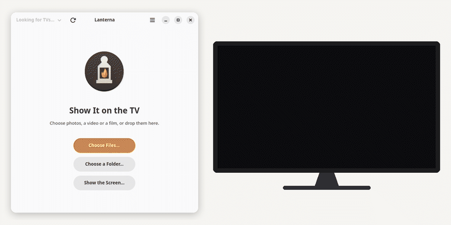
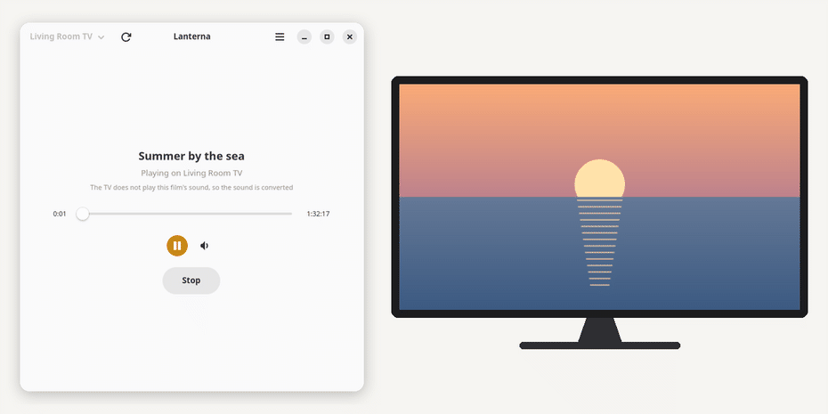
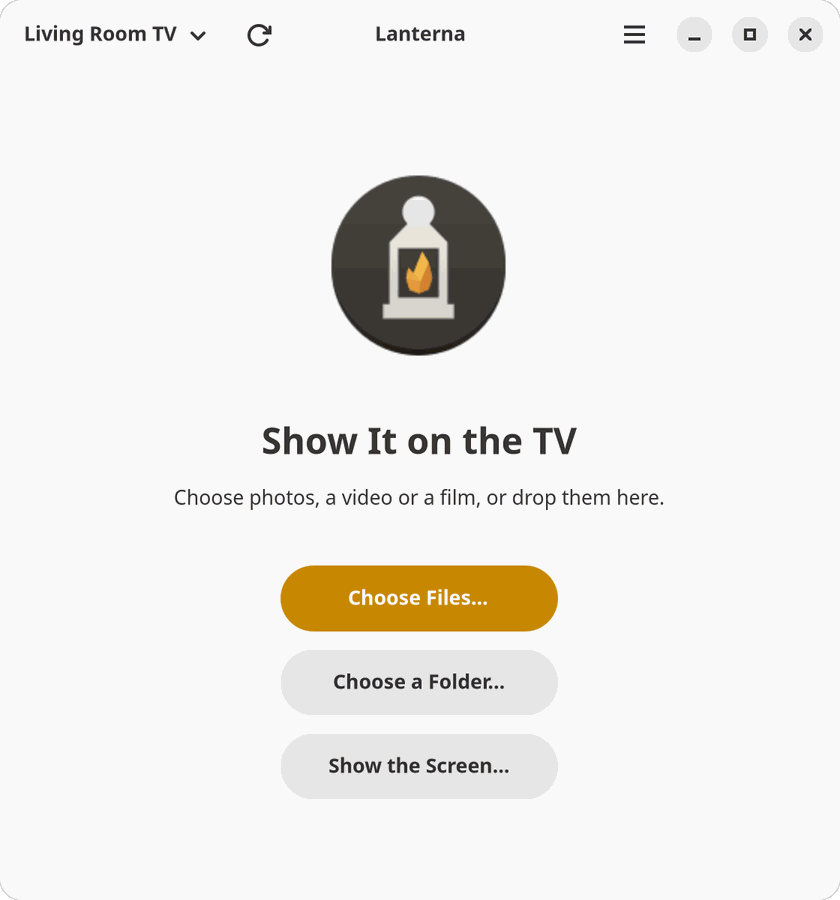
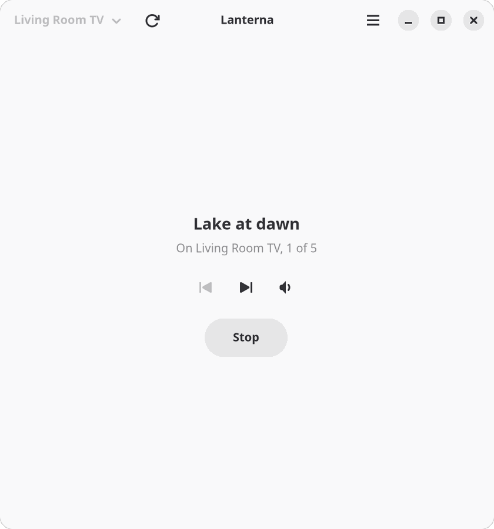
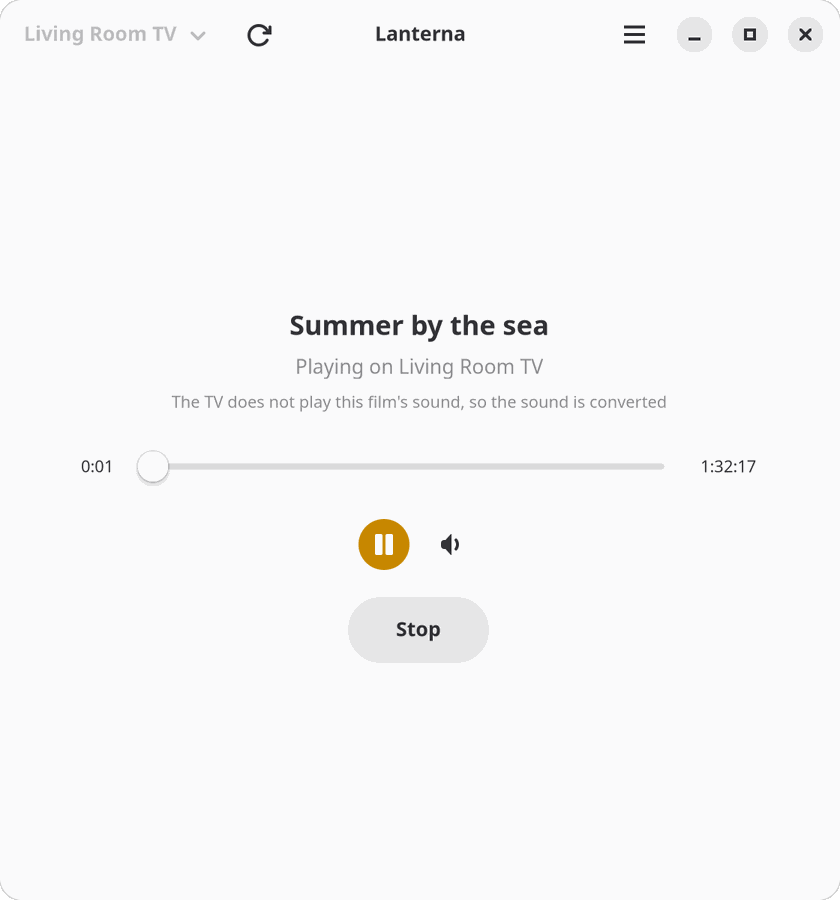
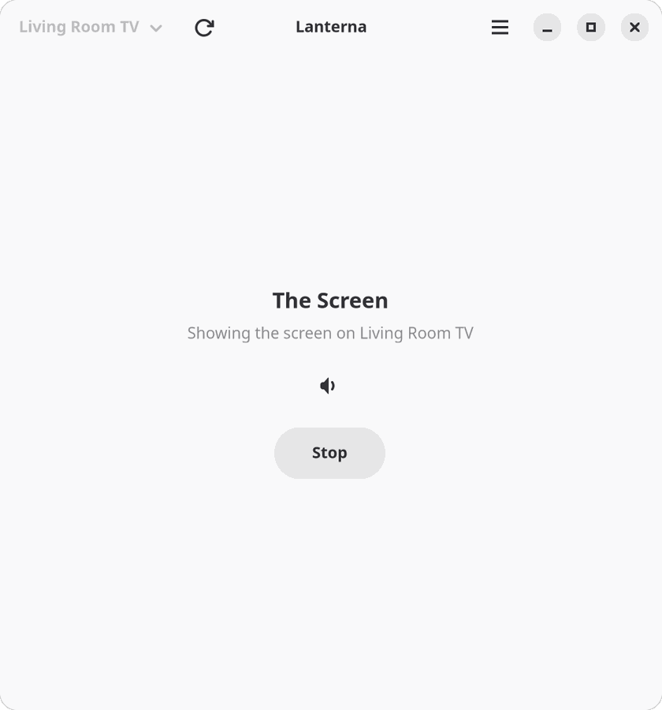
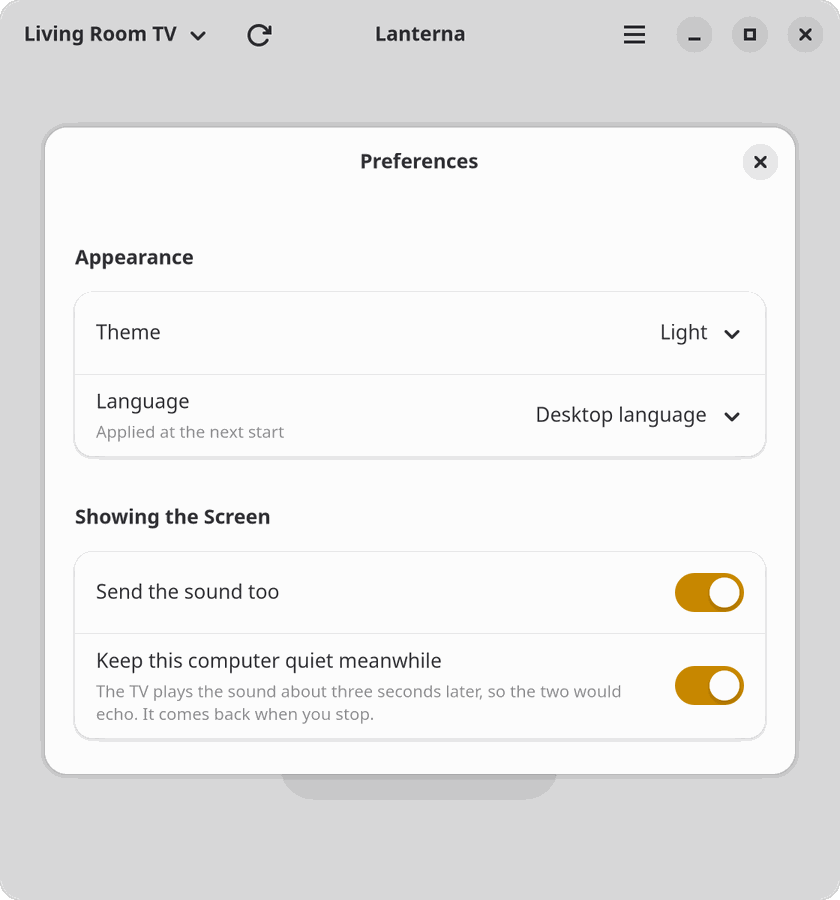
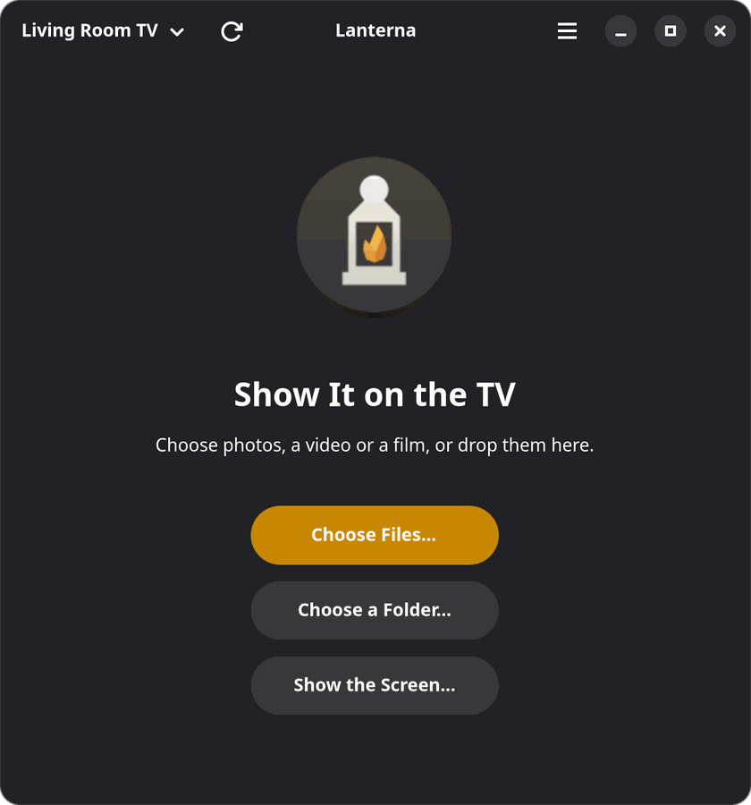

<p align="center">
  
</p>

<h1 align="center">Lanterna</h1>

<p align="center">
  Show photos, videos, films and your screen on the TV, with the Chromecast it has inside.<br>
  <a href="https://daniel-g-carrasco.github.io/lanterna/">daniel-g-carrasco.github.io/lanterna</a>
</p>

Lanterna sends photos, videos and films from this computer to a TV through the Chromecast the TV has inside, and can show the whole screen or a single window there too. I wrote it because I wanted the holiday photos on the living room TV in two clicks, without a browser in between. The TV plays a file itself whenever it can, so the picture keeps its full quality; only what the TV cannot play is converted on the fly. It is a GTK 4 / libadwaita app.

The name is Italian for *lantern*: the magic lantern projected pictures on a wall long before there were screens.

<p align="center">
  
</p>

The design document (in Italian) is [docs/progetto.md](docs/progetto.md). Lanterna is not affiliated with Google; Chromecast is a trademark of Google LLC.

## What it does

- **Finds the TVs** with a Chromecast on the network by itself, and remembers the one you used last. A file opened from the file manager goes straight to that TV.
- **Photos one at a time**, chosen, dropped on the window or a whole folder: Previous and Next in the window, or the arrow keys.
- **Videos and films at full quality.** The TV reads the file from this computer as it is whenever it can play it. When it cannot play only the sound (AC-3 or DTS, common in films), just the sound is converted and the picture goes as it is; only a file the TV cannot play at all is converted whole. The window says which of the three it is.
- **The controls you expect**: pause, the bar to go to another point of the film, the TV's own volume, stop. Space and the arrow keys work them too.
- **The screen or a single window** on the TV, with its sound, through the system's own sharing dialog. Meanwhile this computer keeps quiet, so the sound does not echo from two places, and gets its sound back when you stop.
- **Stays out of the way**: the computer does not go to sleep while the TV is showing something from it, and nothing is uploaded anywhere: the TV and this computer talk only to each other, on your network.

<p align="center">
  
</p>

## Gallery

| | | |
|:---:|:---:|:---:|
|  |  |  |
| Choose what to show | Photos, one by one | A film, at full quality |
|  |  |  |
| The screen on the TV | Preferences | Light and dark |

## Install

### Flatpak

From [the app's own Flatpak repository](https://daniel-g-carrasco.github.io/lanterna/); updates arrive through GNOME Software:

```bash
flatpak install https://daniel-g-carrasco.github.io/lanterna/lanterna.flatpakref
```

The GNOME runtime comes from Flathub. The repository is signed; the key's fingerprint is `8CC3 44A4 0BD6 693E 2295  57FD FBC1 15EC DDE3 477A`. A `.flatpak` bundle is attached to every [release](https://github.com/daniel-g-carrasco/lanterna/releases) too.

### Windows

From the [releases](https://github.com/daniel-g-carrasco/lanterna/releases): `lanterna-setup-vX.Y.Z-windows-x64.exe` installs for the current user (no administrator rights), with a Start menu entry, an uninstaller and a daily check for updates; `lanterna-vX.Y.Z-windows-x64-portable.zip` runs from any folder. Every file is signed with minisign ([code signing policy](CODE_SIGNING.md)); SmartScreen still warns, since there is no Authenticode signature yet. Showing the screen is for Linux only, for now.

### From source

Needs Python 3.11 or newer, PyGObject, GTK 4, libadwaita 1.6 or newer, and GStreamer with its usual plugins (good, bad, ugly and libav) for what has to be converted.

```bash
python3 tools/compile_po.py          # translations (optional)
bin/lanterna                         # the app
bin/lanterna ~/Videos/film.mkv       # shown at once on the TV used last
```

## What the TV needs

A TV or a box with Chromecast built in (Android TV and Google TV ones have it), on the same network as this computer. Lanterna was tried on a Philips Android TV; reports from other TVs are welcome in the [issues](https://github.com/daniel-g-carrasco/lanterna/issues).

## Development

```bash
ruff check --select F,E9,B .                      # lint
python3 -m unittest discover -s tests -v          # all tests (the window's need a display)
python3 tools/compile_po.py --update              # refresh po/lanterna.pot and po/*.po (on Linux)
python3 tools/make_icons.py && python3 tools/make_ico.py   # the icon sizes from the SVG
LANTERNA_SCREENSHOT=/tmp/w.png bin/lanterna       # the window as PNG after 3 s (LANTERNA_SCREENSHOT_DELAY)
```

The tests talk to a fake TV (`tests/_fake_tv.py`), scripted after what a real one answered; the pictures above were taken from the real window driven by those tests, with made-up photos.

A release: the version in `src/lanterna/__init__.py`, the entry in `CHANGELOG.md`, the `<release>` in the metainfo (tests/test_release.py checks they agree), the full suite and the lint, a push, the CI green, then the tag `vX.Y.Z` on that very commit: Build publishes the release with the Flatpak bundle, Windows attaches the installer and the portable zip, Flatpak repository updates the repository on GitHub Pages. The release workflows sign with the key in the `MINISIGN_SECRET_KEY` secret.

## License

MIT, see [LICENSE](LICENSE).
